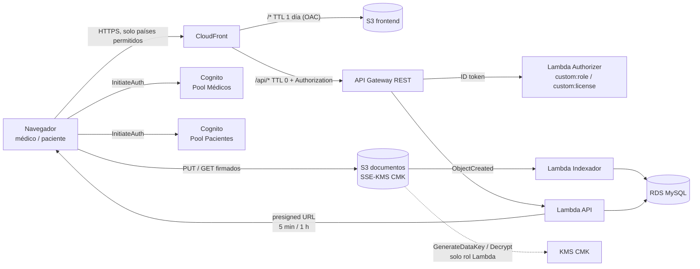

# Plataforma de Telemedicina – Expedientes cifrados

**Servicios:** S3 · Lambda · API Gateway · RDS (MySQL) · CloudFront · Cognito · KMS
**IaC:** Terraform · **Lambdas:** Node.js 20

## Arquitectura



Estructura:

```
terraform/          Infraestructura completa (VPC, KMS, S3, Cognito, RDS, Lambdas, API GW, CloudFront)
lambdas/authorizer  Lambda Authorizer (verifica JWT de ambos pools y aplica permisos por rol)
lambdas/backend     api.mjs (endpoints + presigned URLs) · indexer.mjs (S3 -> RDS) · db.mjs
frontend/           SPA mínima sin dependencias (login, subir, listar, ver)
scripts/            build, creación de usuarios, pruebas de la API y demo de KMS denegado
```

## Despliegue

Requisitos: Terraform ≥ 1.5, Node.js 20+, AWS CLI v2, `jq`, credenciales con permisos de administrador.

```bash
./scripts/build.sh                      # instala dependencias de las Lambdas
cd terraform
terraform init
terraform apply                          # ~10-15 min (RDS y CloudFront son lentos)
cd ..
./scripts/crear-usuarios.sh              # 1 médico + 2 pacientes de prueba
./scripts/probar-api.sh                  # pruebas de punta a punta
./scripts/demo-kms-denegado.sh           # evidencia: la consola no puede leer los documentos
```

Abre la URL de `terraform output cloudfront_url` para usar el frontend.

### Frontend local (sin AWS)

Para probar la interfaz y su flujo completo con datos guardados solo en el
navegador:

```bash
./scripts/frontend-local.sh
```

Abre `http://127.0.0.1:8080`. Puedes iniciar sesión con cualquier correo y
contraseña. Este modo no usa Cognito, S3, KMS ni la API real; Terraform publica
una configuración distinta que activa automáticamente esos servicios.

> **Restricción geográfica:** por defecto solo se permite Colombia (`allowed_countries = ["CO"]`).
> Si pruebas desde otro país CloudFront responde 403; cambia la variable o usa
> `API=$API_DIRECT ./scripts/probar-api.sh` para llamar a API Gateway directamente.

## Cómo se cumple cada requisito

### 1. Cognito: dos User Pools, claims personalizados y Lambda Authorizer

| | Pool Médicos | Pool Pacientes |
|---|---|---|
| Atributos custom | `role`, `license`, `specialty` | `role`, `document_id`, `eps` |
| Valor de `custom:role` | `medico` | `paciente` |
| ¿El usuario puede cambiar su rol/licencia? | No (no están en `write_attributes`) | No |

Los atributos `custom:*` viajan como claims en el **ID token**. El Authorizer (`lambdas/authorizer/index.mjs`):

1. Verifica firma, expiración, `iss` y `aud` contra **los dos pools** (`aws-jwt-verify`).
2. Comprueba que `custom:role` corresponda al pool emisor (un paciente no puede “declararse” médico).
3. Exige que un médico tenga `custom:license` con formato válido (`var.license_regex`).
4. Devuelve una **política IAM** (`execute-api:Invoke`) que solo permite los endpoints de su rol:

| Endpoint | paciente | medico |
|---|:-:|:-:|
| `POST /api/documents/upload-url` | ✅ | ❌ |
| `GET /api/documents` | ✅ | ❌ |
| `GET /api/documents/{id}/download-url` | ✅ (solo propios) | ✅ (con consentimiento) |
| `POST /api/consents` | ✅ | ❌ |
| `GET /api/medico/patients/{patientId}/documents` | ❌ | ✅ (con consentimiento) |
| `GET /api/me` | ✅ | ✅ |

Así se implementan las “políticas IAM basadas en roles de Cognito”: la política que evalúa API Gateway se genera a partir del claim de rol. La Lambda vuelve a validar el rol (defensa en profundidad).

### 2. S3 con SSE-KMS (CMK) y acceso solo para el rol Lambda

`terraform/kms.tf`: la política de clave **no incluye** el statement de root (“Enable IAM User Permissions”), así que ni siquiera `AdministratorAccess` puede usar la clave por IAM. Tiene tres statements:

- `AdministracionSinUso`: quien despliega (tu rol de consola) puede **administrar** la clave (describir, rotar, cambiar política, borrar) pero **no** cifrar/descifrar. Esto evita dejar la clave huérfana.
- `UsoSoloRolLambdaViaS3`: solo `telemed-docs-lambda-role` puede usar `GenerateDataKey`/`Decrypt`, y solo a través de S3 (`kms:ViaService`).
- `DenegarUsoACualquierOtroPrincipal`: Deny explícito para cualquier otro principal.

El bucket aplica SSE-KMS por defecto con la CMK, y su política deniega subidas sin TLS, con otro tipo de cifrado o con otra clave.

**¿Cómo suben/descargan los usuarios?** Con presigned URLs firmadas por el rol Lambda. S3 llama a KMS *en nombre de quien firmó la URL*, así que KMS ve al rol Lambda y lo permite.

**Demostración de acceso denegado desde la consola:**

- *Script:* `./scripts/demo-kms-denegado.sh` (con tus credenciales de consola). Verás algo como:
  `An error occurred (AccessDenied) when calling the GetObject operation: User: arn:aws:sts::…:assumed-role/… is not authorized to perform: kms:Decrypt on resource: arn:aws:kms:… with an explicit deny in a resource-based policy`
- *Consola web:* S3 → bucket `telemed-docs-…` → `patients/…` → objeto → **Abrir** o **Descargar** → error de acceso por KMS. Haz captura de pantalla. Para contrastar, abre ese mismo objeto con la URL que devuelve `/download-url`: sí funciona.
- *CloudTrail:* busca eventos `Decrypt` con `errorCode = AccessDenied` y tu usuario como `userIdentity`.

### 3. CloudFront con dos comportamientos de caché

| Comportamiento | Origen | TTL | Headers reenviados |
|---|---|---|---|
| Default (`/*`) | S3 frontend (OAC) | default/max = **86400 s (1 día)** | ninguno |
| `/api/*` | API Gateway (`/prod`) | min/default/max = **0** | whitelist: `Authorization`, `Content-Type`, `Accept` |

Para `/api/*` se usa la configuración legacy `forwarded_values` con la whitelist de headers, porque CloudFront **no permite** incluir headers en una cache policy con TTL 0, ni reenviar `Authorization` mediante una origin request policy. Además: restricción geográfica por whitelist, HTTPS obligatorio y la política administrada de headers de seguridad.

Verificación:
```bash
curl -sI $CF_URL/index.html | grep -i -E 'x-cache|age|cache-control'   # 2.ª petición: Hit from cloudfront
curl -sI $CF_URL/api/me -H "Authorization: Bearer $TOKEN" | grep -i x-cache  # siempre Miss
```

### 4. Presigned URLs con duración dinámica y validación de propiedad

`lambdas/backend/config.mjs`:

| docType | Content-Type permitidos | Duración de la URL de descarga |
|---|---|---|
| `imagen_diagnostica` | image/jpeg, image/png, application/dicom | **300 s (5 min)** |
| `informe` | application/pdf | **3600 s (1 h)** |

Las URLs de subida duran siempre 5 min. En `createDownloadUrl` (`api.mjs`), antes de firmar:

- **Paciente:** se exige `token.sub === documento.patient_id` (según RDS) **y** que la clave S3 empiece por `patients/{sub}/`. Si no coincide → 403 y queda registrado en `auditoria_accesos`.
- **Médico:** su `sub` nunca coincidirá con el del paciente, así que se exige un consentimiento explícito del paciente (`POST /api/consents`).

`probar-api.sh` muestra `X-Amz-Expires=300` y `X-Amz-Expires=3600`, el 403 cuando otro paciente pide el documento, y explica cómo probar la expiración.

## Modelo de datos (RDS MySQL)

Las tablas se crean automáticamente en el primer arranque de la Lambda (`db.mjs`):

- `documentos`: document_id, patient_id (sub de Cognito), doc_type, file_name, s3_key, content_type, size_bytes, kms_key_arn, version_id, uploaded_at
- `consentimientos`: patient_id, doctor_id
- `auditoria_accesos`: quién generó qué URL, cuándo, con qué duración y si fue denegado

La contraseña de RDS la gestiona RDS en Secrets Manager. Las Lambdas se conectan por TLS verificado. Están en subredes privadas sin NAT (endpoints de S3 y Secrets Manager).

## Notas y limitaciones

- **Videoconferencia:** los servicios del enunciado no incluyen un servicio de video. Para añadirla, lo natural es **Amazon Chime SDK Meetings**: un endpoint `POST /api/consultas/{id}/meeting` en la Lambda que llame a `CreateMeeting` y `CreateAttendee`.
- **API directa:** API Gateway sigue siendo accesible por su URL `execute-api` sin pasar por la restricción geográfica. En producción: AWS WAF con regla geográfica sobre el API o un header secreto de origen que solo envíe CloudFront.
- **Login:** el frontend usa `USER_PASSWORD_AUTH` por simplicidad. En producción conviene SRP o Hosted UI con PKCE y MFA obligatorio.
- **Duración real de la URL:** una presigned URL nunca dura más que las credenciales temporales del rol que la firmó. Con 1 h no hay problema en Lambda.
- **Tamaño de subida:** una presigned PUT no limita el tamaño. Para limitarlo, usa `createPresignedPost` con `content-length-range`.
- **Clave KMS:** si cambias de rol de despliegue, añádelo en `extra_kms_admin_arns` **antes** de perder acceso; de lo contrario solo AWS Support puede recuperar la administración de la clave.

## Costos y limpieza

Los costos principales son RDS `db.t3.micro`, el VPC endpoint de Secrets Manager (~USD 0,01/h por AZ) y la CMK (USD 1/mes). Para borrarlo todo:

```bash
cd terraform && terraform destroy
```

La CMK queda programada para borrarse en 7 días (mínimo que permite AWS).
